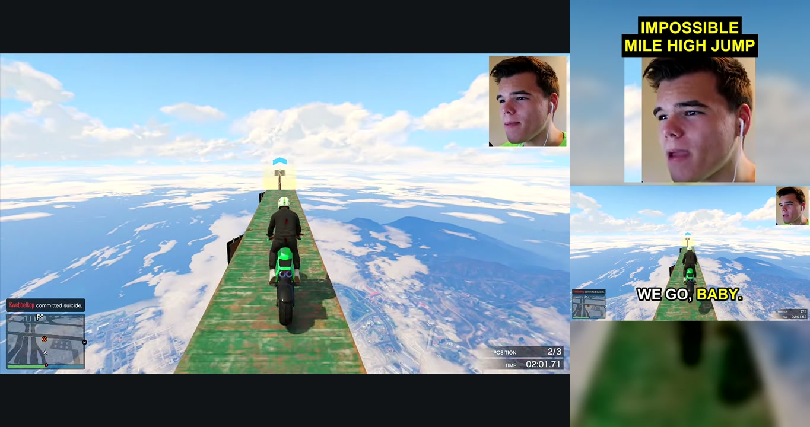

# Gaming Clipper

A local-first, watermark-free AI clipping pipeline and **Agent Skill** (`SKILL.md`) for turning YouTube videos, Twitch/Kick VODs, or local recordings into 1080×1920 vertical Shorts, TikToks, and Reels.



## Features
- **100% Local & Watermark-Free:** Powered by `yt-dlp`, `faster-whisper`, and `ffmpeg` (auto-uses NVIDIA `h264_nvenc` GPU if available, with automatic CPU fallback on Windows, macOS, and Linux).
- **Hype + Transcript Analysis:** Extracts audio energy spikes and word-level timestamps (`analysis.json`).
- **Retention-Ready 9:16 Rendering:**
  - `gaming-split` (default): Fast downscale-blurred 9:16 background + crisp full 16:9 gameplay centered (no lost HUD).
  - `--cam-pos top-left|top-right|bottom-left|bottom-right` (or `--cam-box x,y,w,h`): Optional corner facecam stacked large above gameplay.
  - `center-crop`: Full-screen 9:16 crop for podcasts, interviews, and IRL videos.
  - **Caption Style Presets (`--style`):** `classic` (yellow), `neon` (cyan), `emerald` (green), `fire` (orange), and `clean` (white) — all positioned in the TikTok/Reels/Shorts safe zone (`MarginV=560`).
  - **Auto Speech-Start Snap:** Automatically snaps clip start to the first spoken word so clips never open on dead air.
  - **Ready-to-Post Metadata:** Generates a `.metadata.txt` file alongside every `.mp4`.

---

## Setup (2 Minutes)

### Prerequisites
- [uv](https://docs.astral.sh/uv/) (Python package manager)
- [FFmpeg](https://ffmpeg.org/download.html) on `PATH`

### Install & Verify (Windows / macOS / Linux)
```bash
uv sync
uv run python scripts/check_env.py
```

### Use with Claude Code, Cursor, Antigravity, or any `SKILL.md`-compatible AI
1. Open this folder as your active project/workspace.
2. Ask your AI:
   > "Clip this video into 3 viral shorts: `<YouTube/Twitch URL or local .mp4 path>`"

---

## Context for AI Agents
If you are an AI coding assistant reading this repo for the first time, follow `.agents/skills/gaming-clipper/SKILL.md`:
0. **`scripts/check_env.py`** — Verifies `ffmpeg`, `h264_nvenc` availability, and Python packages.
1. **`scripts/fetch_video.py`** — Downloads a single video (`--no-playlist`, `--max-height 720` recommended for speed) or validates a local file. Outputs JSON with `video_path`.
2. **`scripts/analyze_video.py`** — Extracts 16kHz mono WAV via `ffmpeg`, computes RMS audio energy peaks, and runs `faster-whisper` (loads WAV via `wave` + `numpy` to avoid `PyAV` version issues, and auto-falls back to CPU `int8` if CUDA DLLs are missing). Outputs `workspace/analysis.json`.
3. **Moment Selection** — Read the full `transcript_segments` and `top_energy_peaks` in `workspace/analysis.json`. Pick complete, self-contained 18–45s moments with a strong hook in the first 2 seconds and a 3–5 word ALL-CAPS hook title.
4. **`scripts/render_clip.py`** — Renders 1080×1920 H.264 + AAC (`-14 LUFS` loudnorm) using `h264_nvenc` (or `libx264` fallback), active-word `.ass` captions (`--style`), and writes `<clip>.metadata.txt`.
5. **`scripts/cleanup.py`** — Deletes heavy temporary files in `workspace/source/` and `*_16k.wav` after clips are rendered.

## Manual CLI Example
```bash
uv run python scripts/check_env.py
uv run python scripts/fetch_video.py --source "https://www.youtube.com/watch?v=..." --max-height 720
uv run python scripts/analyze_video.py --input "workspace/source/<id>.mp4" --out workspace/analysis.json --model base
uv run python scripts/render_clip.py --input "workspace/source/<id>.mp4" --analysis workspace/analysis.json --start 120.0 --end 150.0 --title "INSANE MOMENT" --layout gaming-split --style classic --out workspace/clips/clip_01.mp4
uv run python scripts/cleanup.py
```
